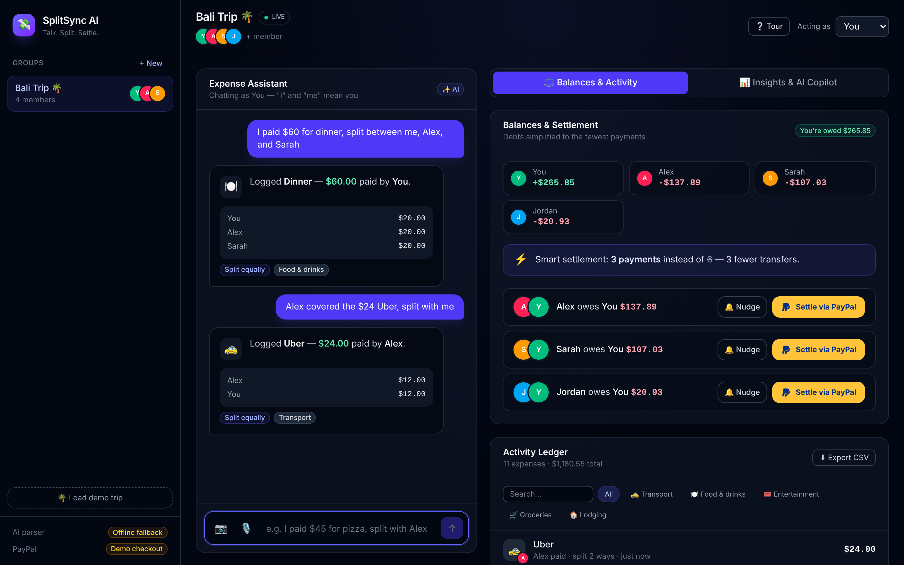
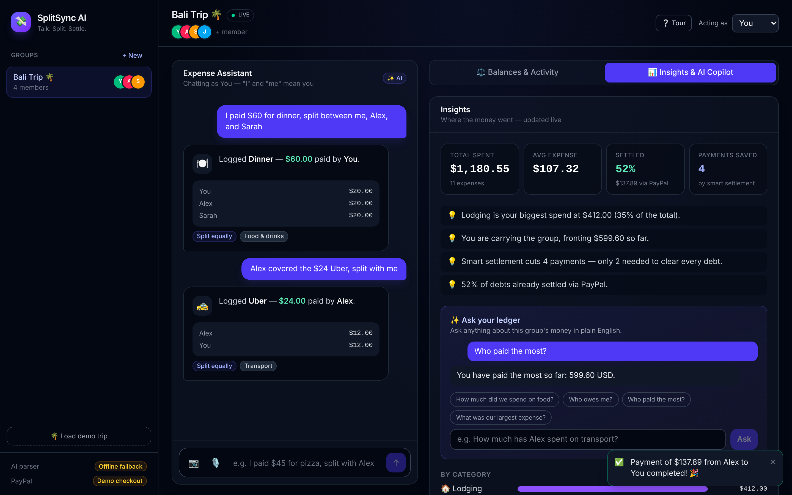
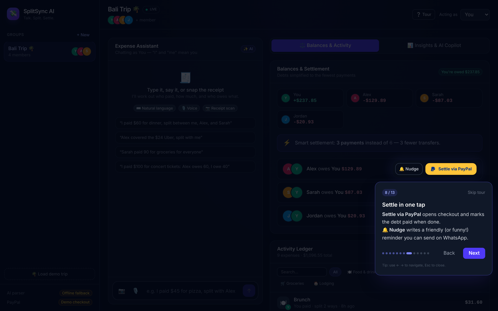
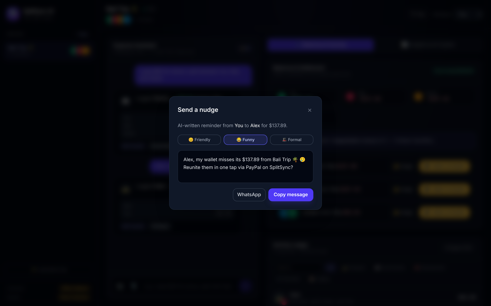
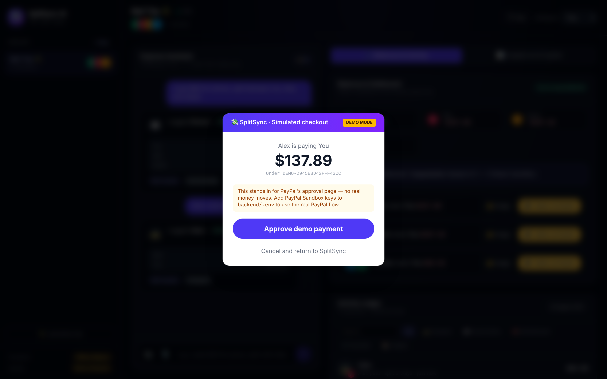
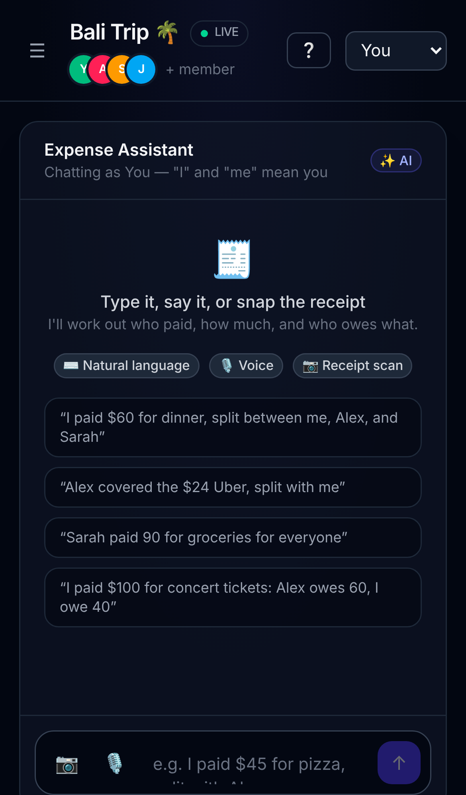
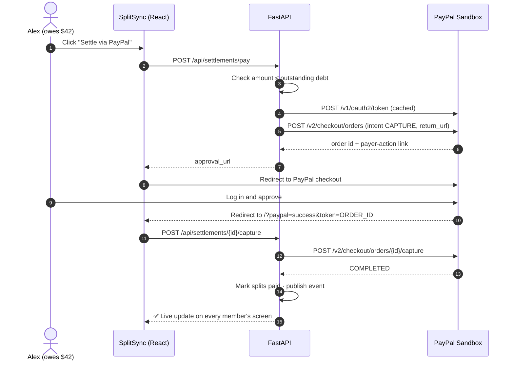
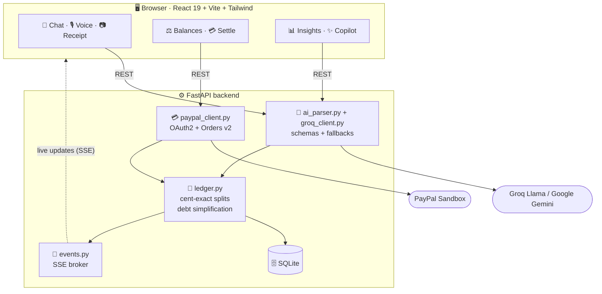

<div align="center">

# 💸 SplitSync AI

### Talk. Split. Settle.

**Split group expenses by just talking. AI does the math, and PayPal settles it in one tap.**

<a href="https://split-sync-ai.onrender.com"></a>

[](https://render.com/deploy?repo=https://github.com/QURSAM-70179225/split-sync-ai)

[](https://github.com/QURSAM-70179225/split-sync-ai/actions/workflows/ci.yml)
[](LICENSE)


**[🌐 Live demo](https://split-sync-ai.onrender.com)** · **[🎬 Video](#-try-it-now)** · **[⚡ Run in 2 min](#-run-it-locally)** · **[🏗️ How it works](#%EF%B8%8F-how-it-works)** · **[🏆 Judges' guide](#-for-judges)**



</div>

---

## 🎯 Try it now

| | |
|---|---|
| 🌐 **Live demo** | **[split-sync-ai.onrender.com](https://split-sync-ai.onrender.com)** |
| 🎬 **Demo video** | **`https://youtu.be/<id>`** ← *replace after uploading* |
| 🧭 **First visit?** | A guided tour starts automatically. Click **Load demo & start** |

> 💡 The hosted demo may take ~50 s to wake up on first load (free tier).

---

## 😩 The problem → 💡 Our solution

| Splitting costs today | With SplitSync AI |
|---|---|
| 📝 Fill a form for every coffee | 🗣️ *"I paid $60 for dinner with Alex and Sarah"*, or **say it**, or **snap the receipt** |
| 🕸️ A web of IOUs: up to *N(N−1)/2* payments | ⚡ **Smart settlement**: at most *N−1* payments ("3 instead of 6") |
| 🙈 "I'll pay you later…" | 💳 **Settle via PayPal** in one tap, plus 🔔 AI-written nudges |
| 🔄 "Did you add it yet?" | 🔴 **Live sync**: every phone updates instantly |

---

## ✨ Features

<table>
<tr>
<td width="50%" valign="top">

### 🗣️ Conversational logging
Plain English becomes a **schema-validated** expense via LLM JSON output (Groq Llama or Gemini). "I"/"me" map to you, nicknames map to members, and the category is detected automatically.

### 📷 Receipt scanning with itemized splits
A vision model (Llama 4 on Groq, or Gemini) reads every line. Add a note like *"Alex had the steak"* and items are assigned per person, with **tax and tip spread proportionally**.

### 🎙️ Voice input
Tap the mic and say it (Web Speech API).

### ⚡ Smart settlement
A greedy debt-simplification algorithm. Exact to the cent, with balances that always sum to zero.

</td>
<td width="50%" valign="top">

### 💳 PayPal settle-up
**Orders v2** create → approve → capture. Idempotent, with overpayment protection, and the related splits are marked paid.

### 🔴 Live multi-device sync
Server-Sent Events push every change to every open screen.

### ✨ AI copilot and 🔔 nudges
*"How much did we spend on food?"* · friendly, funny or formal payment reminders with WhatsApp share.

### 📊 Insights, 🧭 guided tour, 🌴 demo trip
Category breakdown, paid vs. fair share, daily spend. Onboarding tour. One-click demo data.

</td>
</tr>
</table>

<details>
<summary><b>📸 More screenshots (click to expand)</b></summary>
<br>

| Insights & AI copilot | Guided tour |
|---|---|
|  |  |
| **AI nudge (funny tone)** | **Checkout (demo mode, no keys)** |
|  |  |

<p align="center"></p>

</details>

---

## 🏆 For judges

<details open>
<summary><b>How PayPal is used (sponsor integration)</b></summary>

PayPal is the **settlement layer**: every debt is paid through PayPal checkout.



- **OAuth2 client credentials** with a token cache: [`paypal_client.py`](backend/paypal_client.py)
- **Orders v2** with `experience_context` (`PAY_NOW`, `NO_SHIPPING`, return and cancel URLs)
- **Idempotent capture**: `ORDER_ALREADY_CAPTURED` is treated as success, the order ID must match, and overpayment is rejected
- Optional **payee routing** (`PAYPAL_USE_PAYEE_EMAIL=true`) sends money straight to the creditor
</details>

<details open>
<summary><b>How AI is used (Groq · Llama, with Google Gemini as an alternative)</b></summary>

The app runs on **Groq** (fast Llama models) when `GROQ_API_KEY` is set, or **Google Gemini** when `GEMINI_API_KEY` is set. Models are discovered from the provider's live model list, so a retired model name never breaks the app.

| Feature | AI capability | Guardrail |
|---|---|---|
| 🗣️ Text → expense | JSON mode + the `ParsedExpense` Pydantic schema | Cent-exact split math, sum checks, positive amounts |
| 📷 Receipt → itemized split | Vision model + the `ParsedReceipt` schema | Shares scaled to the printed total (tax and tip) |
| ✨ Ask your ledger | Grounded Q&A over a compact ledger JSON | Answers only from the data provided |
| 🔔 Nudges | Tone-controlled generation | Template fallback |

**Every AI feature has a deterministic fallback.** The app fully demos even without a key, and if the AI errors or times out (25 s hard limit) it switches over automatically, and says so in the chat. See [`ai_parser.py`](backend/ai_parser.py).
</details>

<details>
<summary><b>⏱️ 60-second judging path</b></summary>

1. Open the [live demo](https://split-sync-ai.onrender.com). The tour starts. Click **Load demo & start**, then press **Esc**.
2. Type: `Jordan paid $48 for pizza with Alex and Sarah` and watch the parse and split.
3. Look at the **⚡ Smart settlement** banner.
4. Switch **Acting as → Alex**, click **Settle via PayPal**, and approve with a sandbox buyer.
5. Open a second tab, add an expense, and watch the 🔴 **LIVE** toast in the first tab.
6. Go to **📊 Insights**, then ask *"Who paid the most?"*
</details>

---

## 🏗️ How it works



| Layer | Tech |
|---|---|
| Frontend | React 19, Vite, Tailwind CSS v4, EventSource, Web Speech API |
| Backend | FastAPI, SQLAlchemy 2, Pydantic v2, pydantic-settings |
| AI | Groq (Llama 3.3 / Llama 4 vision) over its OpenAI-compatible API, or Google Gemini via `google-genai` |
| Hosting | Render (one-click blueprint, single Docker service) |
| Payments | PayPal REST: OAuth2 + Orders v2 (Sandbox) |
| Ops | Docker (single image), Render blueprint, GitHub Actions, pytest, ruff |

📚 Deep dives: **[ARCHITECTURE.md](ARCHITECTURE.md)** · **[SCHEMA.md](SCHEMA.md)** (ERD + full API) · **[DESIGN.md](DESIGN.md)** · **[PRODUCT_REQUIREMENTS.md](PRODUCT_REQUIREMENTS.md)**

---

## ⚡ Run it locally

> **No API keys needed to try it.** Without keys you get the offline parser and a clearly labelled simulated checkout.

<details open>
<summary><b>🪟 Windows (double-click)</b></summary>

1. Install **[Python 3.12/3.13](https://www.python.org/downloads/)** (tick *Add python.exe to PATH*) and **[Node.js LTS](https://nodejs.org)**.
2. Double-click **`setup.bat`** (once).
3. Double-click **`start.bat`**. The browser opens at http://localhost:5173.
</details>

<details>
<summary><b>🍎 macOS / 🐧 Linux</b></summary>

```bash
git clone https://github.com/QURSAM-70179225/split-sync-ai.git && cd split-sync-ai
```
```bash
make setup
```
```bash
make dev
```
Open http://localhost:5173.
</details>

<details>
<summary><b>🐳 Docker (one container, one URL)</b></summary>

```bash
docker build -t splitsync-ai . && docker run -p 8000:8000 -e SEED_DEMO_ON_START=true splitsync-ai
```
Open http://localhost:8000.
</details>

<details>
<summary><b>🛠️ Manual setup (any OS)</b></summary>

```bash
cd backend && python -m venv .venv && .venv/bin/pip install -r requirements.txt && cp .env.example .env
```
```bash
.venv/bin/python -m uvicorn main:app --reload --port 8000
```
In a second terminal:
```bash
cd frontend && npm install && npm run dev
```
On Windows, use `.venv\Scripts\python` in place of `.venv/bin/python`.
</details>

### 🔑 Add your keys (optional)

Edit **`backend/.env`**:

```ini
GROQ_API_KEY=gsk_...            # https://console.groq.com/keys  (recommended: fast, free tier)
GEMINI_API_KEY=AIza...          # optional alternative: https://aistudio.google.com/app/apikey
PAYPAL_CLIENT_ID=...            # developer.paypal.com → Apps & Credentials → Sandbox
PAYPAL_CLIENT_SECRET=...
```

Restart the backend. The sidebar should show **Groq · …** (or **Gemini · …**) and **Sandbox**. You can also open `/api/health/ai` to run a live AI check. For the sandbox buyer login, see developer.paypal.com → Testing Tools → Sandbox Accounts (*Personal*).

---

## 🚀 Deploy

Click **[Deploy to Render](https://render.com/deploy?repo=https://github.com/QURSAM-70179225/split-sync-ai)**, paste your keys (optional), and click Apply. That's it. Step-by-step instructions and other hosts are in **[DEPLOY.md](DEPLOY.md)**.

---

## 🧪 Quality

```bash
cd backend && .venv/bin/python -m pytest -q && .venv/bin/ruff check .
```

- ✅ **39 tests**: cent-exact splits, balance invariants (Σ = 0), demo settlement and idempotent capture, insights, copilot, nudges, CSV, receipt validation, Groq and Gemini model rollover, AI fallbacks, key scrubbing
- ✅ **CI** on every push: lint, test, frontend build
- ✅ **Safe by design**: secrets stay server-side, uploads are checked for type and size, AI output is validated before it touches money

<details>
<summary><b>📡 API reference (20 endpoints)</b></summary>

| Method | Path | Purpose |
|---|---|---|
| `POST` | `/api/groups/{id}/expenses/parse` | Text → AI → expense + splits |
| `POST` | `/api/groups/{id}/expenses/receipt` | Photo → vision model → itemized expense |
| `GET` | `/api/health/ai` | Live AI check (plain + structured call) |
| `GET` | `/api/groups/{id}/balances` | Net balances + simplified debts |
| `POST` | `/api/settlements/pay` | Create a PayPal order → approval URL |
| `POST` | `/api/settlements/{id}/capture` | Capture the PayPal order |
| `GET` | `/api/groups/{id}/insights` | Analytics |
| `POST` | `/api/groups/{id}/ask` | AI copilot |
| `POST` | `/api/groups/{id}/nudge` | AI reminder |
| `GET` | `/api/groups/{id}/events` | Live SSE stream |

Full list with request and response shapes: **[SCHEMA.md §4](SCHEMA.md#4-rest-api)** · Interactive docs at `/docs` when running.
</details>

---

## 🗺️ Roadmap

- [x] Conversational, voice and receipt logging with AI (Groq or Gemini)
- [x] PayPal Orders v2 settlement with live sync
- [x] Insights, copilot, nudges, guided tour
- [ ] Auth and invite links
- [ ] PayPal webhooks as a capture backup · Payouts to creditors
- [ ] Multi-currency with live FX · recurring expenses

See **[TASK.md](TASK.md)** for the full tracker.

## 🤝 Contributing

PRs welcome! Read **[CLAUDE.md](CLAUDE.md)** (house rules for humans and AI agents). The short version: money is exact, routes stay thin, every AI feature needs a fallback.

## 📄 License

[MIT](LICENSE). Free to use, modify and share.

<div align="center">
<br>
<b>Built with 💜 for the hackathon · Powered by <a href="https://developer.paypal.com">PayPal</a>, <a href="https://groq.com">Groq</a> and <a href="https://render.com">Render</a></b>
</div>
